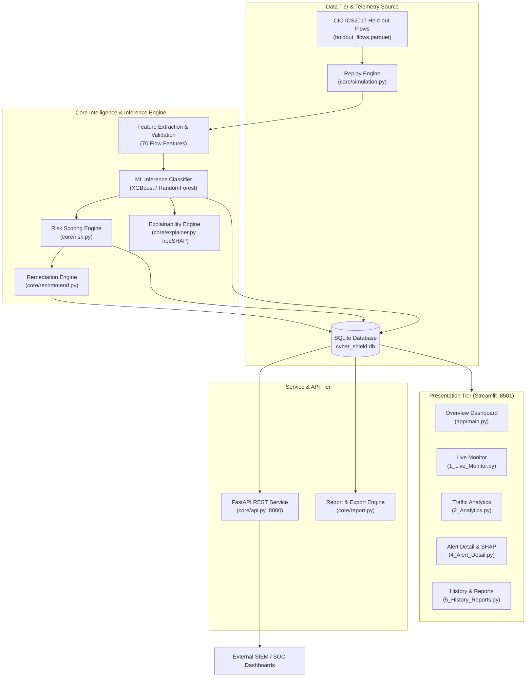

# CyberShield AI — Comprehensive System Architecture

## 1. Executive Summary & Purpose
**CyberShield AI** is an educational and analytical network intrusion detection system (NIDS) simulation platform. It replays held-out telemetry flows from the CIC-IDS2017 benchmark dataset through trained multi-class machine-learning models (XGBoost / Random Forest), calculates explainable feature attributions with TreeSHAP, synthesizes 5-factor heuristic risk scores (0–100), and provides actionable remediation guidance for analyst training.

The platform is engineered exclusively in **read-only replay simulation mode**; it never hooks production interfaces, intercepts traffic, or drops/blocks packets.

---

## 2. High-Level Architecture Diagram

---

## 3. Subsystem Breakdown

### 3.1. Telemetry Ingestion & Replay Engine (`core/simulation.py`)
- **Source Data**: Held-out network flow vectors from the CIC-IDS2017 dataset stored in optimized Apache Parquet format (`data/sample/holdout_flows.parquet`).
- **Replay Modes**: Supports both randomized (`shuffled`) and time-ordered (`chronological`) streams.
- **Batch Processing**: Ingests flows in configurable chunk sizes (e.g., 25–250 flows/batch), tracking session state, active replay runs, and throughput metrics without disk I/O bottlenecks.

### 3.2. Machine Learning Inference Pipeline (`core/pipeline.py`)
- **Trained Classifiers**: High-performance multi-class models (`XGBoost_v0.joblib` and `RandomForest_v0.joblib`).
- **Feature Set**: Evaluates 70 bidirectional flow features (inter-arrival times, packet length distributions, TCP flags, subflow metrics, window sizes).
- **Latency**: Sub-millisecond inference (~1.2 ms per flow vector).
- **Safety Checks**: Validates feature integrity, catches non-finite values (NaN / Inf), and guards against missing feature vectors.

### 3.3. Explainable AI Engine (`core/explainer.py`)
- **Attribution Model**: Utilizes TreeSHAP (SHapley Additive exPlanations) to measure local marginal contributions of individual network features.
- **Explainability Output**: Shows whether a feature pushed the decision toward an attack class or toward benign traffic, paired with cross-validation stability tags (`stable_features.json`).

### 3.4. Dynamic Heuristic Risk Scoring (`core/risk.py`)
The risk score (0 to 100) is synthesized using a 5-factor weighted heuristic formulation:
1. **Category Severity (40%)**: Base severity of the predicted attack class (e.g., DDoS: 0.95, DoS: 0.85, Bot: 0.90, PortScan: 0.40).
2. **Confidence (25%)**: Softmax prediction certainty emitted by the classifier.
3. **Volume (15%)**: Frequency of identical attack classes observed within the recent sliding window.
4. **Breadth (10%)**: Number of distinct destination ports targeted from the same source IP.
5. **Repeat (10%)**: Frequency of prior violations linked to the source IP.

$$\text{Risk Score} = 100 \times \sum_{i=1}^{5} (w_i \times v_i)$$

**Severity Levels**:
- **Low**: $0 < \text{Score} < 60$
- **Medium**: $60 \le \text{Score} < 80$
- **High**: $80 \le \text{Score} < 90$
- **Critical**: $90 \le \text{Score} \le 100$

### 3.5. Persistence & Data Storage (`core/db.py`)
- **Database Engine**: Embedded SQLite database (`data/cyber_shield.db`).
- **Tables**:
  - `runs`: Replay execution sessions, metadata, and timestamps.
  - `alerts`: Detected flow anomalies, predictions, risk metrics, and top SHAP features.
- **Defenses**: Fully parameterized queries prevent SQL injection attacks. Dynamic column filtering is restricted against strict allowlists.

### 3.6. REST API Service (`core/api.py`)
- Built on **FastAPI** running on port 8000.
- Serves read-only endpoints:
  - `GET /health`: Engine status and simulation indicators.
  - `GET /api/summary`: Aggregated flow totals, attack breakdowns, and risk distributions.
  - `GET /api/alerts`: Filterable flow query endpoint (by class, severity, IP).
  - `GET /api/alerts/{id}`: Detailed single incident vector retrieval.
  - `GET /api/recommend`: Remediation playbook lookup.

### 3.7. User Interface Tier (`app/`)
- Built with **Streamlit** (dark cyber theme on port 8501).
- **Navigation & Layout**:
  - `main.py`: Modern SOC landing interface featuring the custom dark aesthetic, emerald striated visual refraction, live system counters, and module routing.
  - `1_Live_Monitor.py`: Interactive flow playback controller with speed adjustments and real-time risk gauges.
  - `2_Analytics.py`: Traffic distributions, predicted class counts, and timeline activity analysis.
  - `4_Alert_Detail.py`: Deep-dive flow analysis, local SHAP attribution charts, and ground truth validation.
  - `5_History_Reports.py`: Filterable historical incident log viewer with progress indicators, CSV export, and sanitized HTML report generation.

---

## 4. Security & Safety Principles
1. **Zero Active Interruption**: The software operates strictly in simulation mode. No network interfaces are hooked, and no packets are dropped or blocked.
2. **Formula Neutralization**: CSV exports sanitize spreadsheet formula injection characters (`=`, `+`, `-`, `@`).
3. **HTML Sanitization**: HTML incident reports escape all user-controllable or attacker-influenced fields to prevent Cross-Site Scripting (XSS).
4. **Path Traversal Constraints**: Configured paths are strictly sandboxed inside the repository boundaries.
